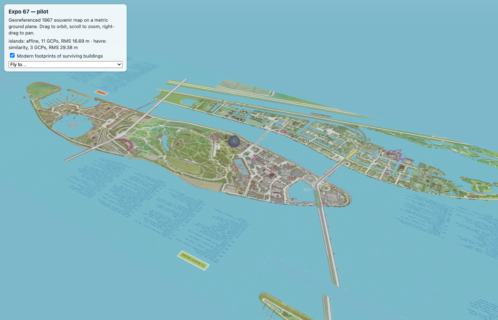

# Expo 67 model

A 3D rendition of the Expo 67 site in Montréal, served in the browser with three.js.



## Status: pilot, step 1 done

- The 1967 Official Souvenir Map is georeferenced onto a metric ground frame.
- A three.js viewer shows the warped map, the modern footprints of surviving buildings, and a to-scale Biosphère placeholder.

## Coordinate frame

The frame is NAD83 / MTM zone 8 (EPSG:32188, the City of Montréal's grid), shifted to a local origin at E 302000, N 5040000. Units are metres, +x is east and +y is north. In three.js, local (x, y) becomes (x, 0, −y). See `tools/common.py`.

## Layout

```
sources/        raw inputs (see sources/SOURCES.md for licences)
data/osm/       Overpass dumps + derived reference.geojson (local metres)
data/georef/    gcps.json (hand-picked control points), transforms.json, QA overlays
tools/          Python pipeline
web/            Vite + three.js viewer; web/public/ holds generated assets
```

## Pipeline

```sh
python3 -m venv .venv && .venv/bin/pip install -r requirements.txt
.venv/bin/python tools/osm_reference.py     # OSM -> reference.geojson + reference.png
.venv/bin/python tools/georef_fit.py        # fit per-panel transforms, print residuals
.venv/bin/python tools/georef_warp.py --mpp 1.0   # warp panels, write QA overlays + web textures
.venv/bin/python tools/export_landmarks.py  # surviving-building positions for the viewer
cd web && npm install && npm run dev
```

To add a control point:
1. Run `tools/crop_grid.py` on the map to read the pixel position.
2. Add the point to `data/georef/gcps.json`.
3. Rerun the fit and warp scripts.
4. Check `data/georef/*_overlay.jpg`. The red lines are modern shores and the magenta shapes are modern buildings.

## Georeferencing findings

- The souvenir map is a near-planimetric illustration at about 2 px/m. Buildings are drawn slightly oblique.
- The two islands, **Sainte-Hélène and Notre-Dame**, share one consistent geometry. An affine fit from 11 points gives **17 m RMS**. The illustrator stretched the cross-river axis by about 13%.
- **Cité du Havre** was drawn as a separate, displaced panel and gets its own transform. Its 3-point similarity fit gives **29 m RMS**, which is too few points.
- Ste-Hélène's modern shoreline matches the 1967 drawing closely. Notre-Dame was reshaped after 1967 by the Olympic basin and the beach, so its modern shore is not a control.

## Known gaps

- The affine error is 15–35 m. That is good enough for the layout, but too coarse to place pavilions. Next step: add 20–30 more control points and switch to a thin-plate-spline (rubber-sheet) warp.
- The souvenir map is an illustration. Pavilion footprints should be checked against the LAC 1967 blueprint or the 1966–67 aerial photos before modelling.
- Legend text on the scan shows up as floating text on the water.
- The terrain is flat. The 1967 shorelines and Notre-Dame's canals and lagoons are not modelled yet.
